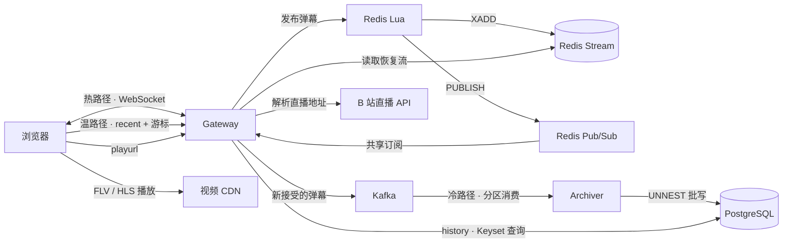

# Maku

Maku 是分布式实时弹幕系统。**Gateway** 负责 WebSocket 广播和断线补收，**Archiver** 独立消费 Kafka 并批量写入 PostgreSQL，让在线观众收到弹幕的延迟与历史入库耗时解耦。HTTP 路由与日志使用 Go 标准库 `net/http.ServeMux` 和 `log/slog`。Go 模块只有 5 个直接依赖：`gorilla/websocket`、`go-redis/v9`、`franz-go`、`pgx/v5`、`prometheus/client_golang`。

## 系统架构



## 核心工程设计与权衡

1. **一次 Redis 调用确定发布顺序。** 房间与场次组成逻辑房间 ID，相关键使用相同的 `{room}` Hash Tag，兼容 Redis Cluster 同槽执行。Lua 先按访客与 `client_msg_id` 去重，10 分钟内重试返回原 `event_id`；新请求通过禁言与限流检查后，脚本追加恢复流并发布。信封直接嵌入原始 JSON，避免 Lua 解码再编码导致 `uint64` 精度损失。
2. **把合批延迟留给突发流量。** 默认 8 条 Redis 共享订阅连接复用活跃房间，32 个下行 worker 按房间分片，使用不可变成员快照扇出。本机同房间协商 `danmaku.batch.v1` 的观众达到 128 人、相邻消息到达间隔 ≤ 2 ms 时启动合批。窗口为 5 ms，每批上限 32 条或 32 KiB，普通客户端仍收单条帧。单连接队列默认最多 512 帧、256 KiB，连续 8 次入队失败会关闭慢连接。
3. **用同一游标处理断线与滚动发布。** 浏览器检查 `prev` 与本地游标，发现缺口便携 `epoch@stream-id` 调用 `recent`。恢复流约保留 256 条，停写 120 秒后过期；游标失效时按近期快照重置。收到 `SIGTERM` 后网关先使 `/readyz` 返回 503，再按批次与在途上限发出 Migrate 帧。入口摘流后，客户端经同一入口建新连接，补收期间保留旧连接，只应用尚未处理的后缀。新连接接管后主动关闭旧连接。交接结束或超时后，网关执行 HTTP Shutdown、关闭连接并 Drain Kafka。
4. **让归档批次可以重放。** Kafka 使用 `LeaderAck`。Archiver 按分区用 5 个数组绑定参数执行 PostgreSQL `UNNEST` 批写，`ON CONFLICT (event_id) DO NOTHING` 吸收重复投递。瞬时写入错误按带抖动的指数退避重试，SQLSTATE 类别 22/23 则降级逐条写入，将坏记录记入死信日志与指标。批次处理完再提交位点，停机时已落库批次有 3 秒提交宽限。历史查询沿 `(room_id, id DESC)` 索引按 `before_id` 翻页，使用 `NOT EXISTS` 过滤撤回记录，避免深分页跳过大量行。
5. **限制过滤与回源的开销。** Aho-Corasick 自动机通过 `atomic.Pointer` 提供无锁词库快照，`SIGHUP` 重载成功后原子替换；未命中时匹配与打码均为 0 B、0 次分配。直播源由独立的 6 秒超时 HTTP 客户端解析，同房间并发请求共享一次回源。缓存上限 512 项，开播与未开播结果分别缓存 15 秒和 5 秒。视频由浏览器直连 CDN。
6. **区分发布回执、历史记录与统计。** `accepted` 表示 Redis 已接受广播与恢复流写入。网关随后异步投递 Kafka，进程崩溃或生产者缓冲区满时，已发布弹幕可能缺失历史。在线人数和点赞先在网关内存中汇总，再周期性通过 Redis 聚合，客户端看到的是最终一致的统计快照。

## 实测性能概览

Apple M4、macOS arm64、Go 1.27.4。扇出与迁移为同机单轮短测；微基准按各项记录的采样方法统计。[测试环境、原始结果与复现命令](docs/benchmarks.md)

| 场景 | 条件 | 实测结果 |
| --- | --- | --- |
| 单网关热房扇出 | 160 位观众，800 条/秒，4 秒，单条帧 → 合批 | 两轮各收齐 512,000 次投递。数据帧 512,000 → 128,160（减少 74.97%），热房 P50 1.306 → 4.032 ms，P99 11.457 → 10.728 ms |
| 双网关滚动交接 | 各 12 位观众，每批 4 位，在途上限 2 | 源端 12 位全部迁移，24 位各按序收齐 80 条。最后一位于 606 ms 完成交接，单人恢复 P99 为 6 ms |
| 敏感词过滤 | 5,000 个五字词，100 字输入 | 未命中 Contains / Mask 分别为 1.339 / 1.288 µs，均为 0 B、0 次分配。命中 Mask 为 3.553 µs、2,528 B、4 次分配 |
| 移除网络 I/O 外层锁 | 三轮中位数，修改前 → 后 | 本地完整扇出 10,000 人为 244783 → 236425 ns/op，均为 176 B、4 次分配。Redis 房间入退订为 219347 → 234308 ns/op |
| PostgreSQL 批写 | 每批 128 条，三轮各 100 批，中位数 | 6 → 5 个绑定数组：1.624 → 1.588 ms/批，74,600 → 71,236 B/批，965 → 961 次分配/批 |

## HTTP 与 WebSocket 接口

房间与场次各允许 1–24 个 ASCII 字母、数字、下划线或短横线。先创建访客会话，再用同源 Cookie 建立 WebSocket。

| 方法 | 路径 | 用途 |
| --- | --- | --- |
| POST | `/api/session` | 创建或复用访客身份，返回 `user_id`，新会话设置 HttpOnly Cookie |
| GET / WS | `/api/rooms/{room}/{session}/live` | 弹幕与点赞上行，弹幕、统计与回执下行。以 `?migrate=1` 接受迁移邀请，可协商 `danmaku.batch.v1` |
| GET | `/api/rooms/{room}/{session}/recent` | `after` 传恢复游标，返回 `events`、`pos`、`reset` |
| GET | `/api/rooms/{room}/{session}/history` | 按 ID 倒序，`limit` 默认 50，上限 100。有下一页时用 `next_before_id` 作为下次的 `before_id` |
| POST | `/api/rooms/{room}/{session}/moderate` | 同源校验、房间授权、Bearer 密钥。按 `event_id` 撤回，或按 `user_id` 禁言指定秒数 |
| GET | `/api/live/playurl?room_id=6` | 解析数字直播间，返回开播状态与可用播放地址 |
| GET | `/livez` | Gateway 与 Archiver 进程存活探针 |
| GET | `/readyz` | Gateway 检查退役状态、Redis 与 PostgreSQL；Archiver 检查 PostgreSQL。未就绪返回 503 |
| GET | `/metrics` | Prometheus 指标。Gateway 使用业务端口，Archiver 的三个管理接口需显式启用 `-metrics-addr` |

## 项目结构

```text
maku/
├── cmd/
│   ├── gateway/        # 实时弹幕网关进程
│   ├── archiver/       # Kafka -> PostgreSQL 异步归档进程
│   └── bench/          # 扇出、冷热房隔离、滚动迁移压测工具
├── internal/
│   ├── filter/         # Aho-Corasick 敏感词过滤与热加载
│   ├── httpapi/        # HTTP/WebSocket 路由、访客会话、直播源解析及内嵌 web 资源
│   ├── hub/            # 房间管理、分片派发、自适应合批、背压与滚动迁移
│   ├── metrics/        # Prometheus 业务与归档指标
│   ├── mq/             # Kafka 生产者与批量消费者（含退避重试）
│   ├── protocol/       # WebSocket 协议帧与消息结构定义
│   ├── pubsub/         # Redis Lua 原子日志流、共享订阅多路复用与统计
│   └── store/          # PostgreSQL 连接池、内嵌迁移与 UNNEST 批量写入
├── frontend/           # 放映室前端源码（Vite + TypeScript + React）
├── deploy/             # Prometheus 抓取配置
├── docs/               # 基准测试报告（benchmarks.md）
└── scripts/            # 端到端恢复与迁移校验脚本
```

## 快速开始

需要 Go 1.27.4、Docker Compose 和 Make。仓库内嵌放映室构建产物，可直接启动两个 Go 进程。

```sh
make up
make run-archiver    # 终端一
```

```sh
make run-gateway     # 终端二
```

打开 `http://127.0.0.1:8080/`。两个浏览器进入相同房间与场次即可互发弹幕。数字房间号同时启用 B 站直播源解析，其他房间只启用弹幕。修改前端后，执行以下命令并重启网关以载入新产物。

```sh
(cd frontend && npm ci && npm run build)
```

## 配置

| 范围 | 配置项 | 默认值或含义 |
| --- | --- | --- |
| 中间件 | `REDIS_ADDR` / `KAFKA_BROKERS` | `127.0.0.1:6379` / `127.0.0.1:9092`；多个地址以逗号分隔 |
| 存储 | `DATABASE_URL` | 本机 PostgreSQL 5432 的 `danmaku_db`，默认凭据与 Compose 一致 |
| 房管 | `DANMAKU_MOD_ROOM` / `DANMAKU_MOD_TOKEN` | 同时设置房间名与密钥后可执行房管操作 |
| Gateway 监听 | `-host` / `-port` | `127.0.0.1` / `8080` |
| 扇出 | `-pubsub-shards` / `-room-shards` / `-send-queue` | 8 条订阅连接 / 32 个下行分片 / 每连接 512 帧 |
| 合批 | `-batch-min-viewers` / `-batch-arrival-gap` / `-batch-window` | 128 人 / 2 ms / 5 ms |
| 迁移 | `-migration-batch` / `-migration-inflight` / `-migration-timeout` | 每 100 ms 最多邀请 100 位 / 最多 64 位在途 / 30 秒 |
| 词库 | `-sensitive-words` / `-filter-mode` | 默认不加载词库。文件每行一词，`reject` 拒绝命中消息（默认），`mask` 打码 |
| 开发身份 | `-allow-dev-guest` | 默认关闭。启用后允许回环地址且无 Origin 的客户端以 `uid` 入房 |
| Archiver 管理端口 | `-metrics-addr` | 默认关闭。例：`make run-archiver ARGS='-metrics-addr 127.0.0.1:9091'` |
| 日志 | `-log-format` | 两个进程均支持 `json`（默认）和 `text` |

## 可观测性与验证

网关暴露活跃连接与房间数、单条与合批写帧数、分片排队延迟、队列丢弃、慢连接踢出、上行拒绝及 Kafka 投递失败。归档器暴露写入行数、批写耗时与死信数。指标标签仅使用模式、原因等有限枚举。

```sh
make up-monitoring
curl -fsS http://127.0.0.1:8080/metrics
```

Prometheus 默认监听 `127.0.0.1:9090`，可用 `PROMETHEUS_PORT` 覆盖。容器通过 `host.docker.internal:8080` 抓取网关；启用归档器抓取时，配置容器可达的管理监听地址，并取消抓取配置中的对应注释。[Prometheus 配置](deploy/prometheus.yml)

```sh
gofmt -l .
go vet ./...
make test            # go test -race ./...

# 启动中间件与服务后运行；migration 自行启动两台临时网关
make bench-fanout ARGS='-viewers 160 -rate 800 -seconds 4'
go run ./cmd/bench rooms
go build -o /tmp/maku-gateway ./cmd/gateway
go run ./cmd/bench migration -gateway /tmp/maku-gateway -viewers 24 -batch 4 -inflight 2
```

设置 `DANMAKU_TEST_REDIS_ADDR`、`DANMAKU_TEST_DATABASE_URL` 可分别启用中间件集成测试。跨网关重试测试需要 `DANMAKU_TEST_GATEWAY_A`、`DANMAKU_TEST_GATEWAY_B` 与运行中的归档器；设置 `DANMAKU_MOD_ROOM=retry` 及对应密钥可覆盖房管分支。浏览器级迁移、恢复场景见 [check-migration.cjs](scripts/check-migration.cjs) 和 [check-recovery.cjs](scripts/check-recovery.cjs)。
