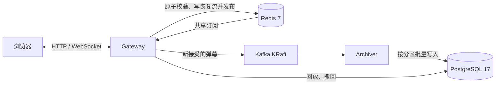

# Live Stream Danmaku

Go 弹幕网关与历史归档服务。浏览器可以在房间内发言、点赞、补收离线期间的消息，并按媒体时间查询回放。每个房间可包含多个独立场次。



## 本地启动

需要 Go 1.27.4、Docker Compose 和 Make。在项目根目录执行以下命令，两个 Go 服务各占一个终端。

```sh
make up
make run-archiver
# 在另一个终端
make run-gateway
```

打开 [本地放映室](http://127.0.0.1:8080/)。默认画面为 60 秒循环计时，可导入本地视频与弹幕 JSON 回放。用相同的房间名和场次打开第二个窗口，即可观察广播。

## 发送与恢复

- 网关先分配 HttpOnly 访客 Cookie，再通过 `/api/rooms/{room}/{session}/live` 建立 WebSocket。Lua 在同一房间哈希槽内检查幂等键、禁言及限流，追加恢复流并广播。原始 JSON 进入嵌套信封，64 位用户 ID 不经过 Lua 浮点转换。
- 最近消息保留约 256 条，房间停止写入 120 秒后过期。客户端用 `/recent?after=游标` 补收，游标过期时按返回的快照重置。相同用户和请求 ID 在 10 分钟内重复发送，会获得原事件 ID。
- 每个网关默认使用 8 条 Redis 订阅连接。协商批协议的本地观众达到 128 人且连续到达间隔不超过 2 ms 时，网关最多聚合 5 ms、32 条或 32 KiB。32 个派发分片共享房间成员快照。每个连接最多积压 512 帧和 256 KiB，连续 8 次入队失败即关闭。
- 接受新事件后，网关将其送入有界 Kafka 生产缓冲区。实时回执表示 Redis 已接受消息。网关在投递前崩溃、缓冲区耗尽或 Kafka 写入失败时，已广播的消息可能缺少历史记录。`/metrics` 提供异步投递失败计数。归档器按分区执行 PostgreSQL `UNNEST` 批写，在保存后提交位点，用唯一事件 ID 吸收重放。数据或约束错误触发逐条隔离与死信日志。
- 收到 SIGTERM 后，网关先让 `/readyz` 返回 503 并拒绝新连接，再每 100 ms 分批邀请客户端迁移。客户端通过同一入口连接可用网关，补齐游标后释放旧连接。网关在交接结束或超时后关闭连接并刷新生产缓冲区。多实例部署需要入口按就绪状态摘除退役网关。

## 配置与验证

| 配置 | 默认值或作用 |
|---|---|
| `REDIS_ADDR` | `127.0.0.1:6379`，集群可提供逗号分隔的种子地址 |
| `KAFKA_BROKERS` | `127.0.0.1:9092`，多个地址以逗号分隔 |
| `DATABASE_URL` | Compose 默认连接到本机 5432 的 `danmaku_db` |
| `DANMAKU_MOD_ROOM`、`DANMAKU_MOD_TOKEN` | 两项都配置后，指定房间可使用 Bearer 密钥撤回或限时禁言 |
| `-pubsub-shards`、`-room-shards` | 每个网关的 Redis 订阅连接和下行派发分片数 |
| `-migration-batch`、`-migration-inflight`、`-migration-timeout` | 默认每批 100 个邀请、最多 64 个在途交接、30 秒超时 |
| `-log-format` | 两个服务都支持 `json`（默认）和 `text` |
| `-allow-dev-guest` | 默认关闭。启用后，回环地址上无 Origin 的压测客户端可用 `uid` 参数建连 |

```sh
make test
go vet ./...
make bench-fanout ARGS='-viewers 160 -rate 800 -seconds 4'
go run ./cmd/bench rooms
go build -o /tmp/danmaku-gateway ./cmd/gateway
go run ./cmd/bench migration -gateway /tmp/danmaku-gateway -viewers 24
```

设置 `DANMAKU_TEST_REDIS_ADDR`、`DANMAKU_TEST_DATABASE_URL` 可启用 Redis 与 PostgreSQL 集成测试。双网关测试还需将 `DANMAKU_TEST_GATEWAY_A` 和 `DANMAKU_TEST_GATEWAY_B` 指向共享测试栈的网关并运行归档器。房管测试使用 `DANMAKU_MOD_ROOM=retry` 和相同密钥。

压测环境、复现命令和实测结果见[基准报告](docs/benchmarks.md)。
