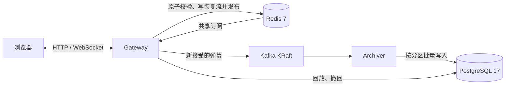

# Live Stream Danmaku

Go 实时弹幕服务。同一房间、同一场次的观众可以跨网关收发弹幕和点赞。短时断线后，客户端按游标补收消息；观看回放时，按媒体时间查询历史弹幕。

服务分为两个进程。网关负责 HTTP、WebSocket 和实时广播，归档器消费 Kafka 并批量写入 PostgreSQL。HTTP 路由和日志使用标准库 `net/http.ServeMux` 和 `log/slog`。四个直接依赖分别是 Gorilla WebSocket、go-redis、franz-go 和 pgx。



## 本地启动

需要 Go 1.27.4、Docker Compose 和 Make。在项目根目录执行以下命令，两个 Go 服务各占一个终端。

```sh
make up
make run-archiver
# 在另一个终端
make run-gateway
```

打开 [本地放映室](http://127.0.0.1:8080/)。默认画面为 60 秒循环计时，可导入本地视频与弹幕 JSON 回放。用相同的房间名和场次打开第二个窗口，即可观察广播。

## 一条弹幕如何送达

1. **接受消息。** 浏览器取得 HttpOnly 访客 Cookie 后，连接 `/api/rooms/{room}/{session}/live`。Redis Lua 脚本在同一哈希槽中完成请求去重、禁言检查、限流、追加恢复流和发布。广播信封保留原始 JSON，避免 64 位用户 ID 丢失精度。同一访客在同一场次用相同请求 ID 重试，10 分钟内会收到原事件 ID。
2. **广播与补收。** 网关默认用 8 条 Redis 订阅连接服务全部活跃房间，32 个下行分片按成员快照派发消息。本地支持批协议的观众达到 128 人、相邻消息间隔不超过 2 ms 时，网关最多等待 5 ms，每批最多 32 条或 32 KiB。断线客户端通过房间的 `recent` 接口提交最后收到的游标；恢复流保留约 256 条，停写 120 秒后过期。游标失效时，客户端用返回的快照重置。
3. **写入历史。** 网关只将新接受的事件送入有界 Kafka 缓冲区。**发送回执表示 Redis 已接受消息。** 如果进程在投递前崩溃、缓冲区已满或 Kafka 写入失败，已广播的消息可能缺少历史记录。归档器按分区执行 PostgreSQL `UNNEST` 批写，通过唯一事件 ID 去重，处理完批次后才提交消费位点。暂时性故障触发带抖动的指数退避；SQLSTATE `22`、`23` 类错误触发逐条写入，坏记录进入死信日志。

## 连接与滚动发布

每个连接每 30 秒发送一次 Ping，收到 Pong 后将读期限延长至 60 秒。待写队列上限为 512 帧和 256 KiB；连续 8 次入队失败会关闭慢连接。

网关收到 SIGTERM 后，`/readyz` 返回 503，入口应将该实例摘流。网关每 100 ms 分批通知观众迁移，一轮交接共用同一条通知帧。客户端连到可用网关并补齐游标后关闭旧连接。交接结束或超时后，退役网关关闭连接并刷新 Kafka 生产缓冲区。

## 实测结果

在 Apple M4 上的一轮 4 秒短测中，热房每秒接收 800 条弹幕，160 位观众合计收齐了 512,000 次投递。自适应合批将热房数据帧从 512,000 减少到 128,160，降幅为 74.97%；热房 P99 从 11.457 ms 变为 10.728 ms。

双网关滚动发布测试中，24 位观众均按序收齐 80 条消息。源网关的 12 位观众全部完成迁移，最后一位在 606 ms 完成交接。环境和复现命令见[基准报告](docs/benchmarks.md)。

## 配置与验证

| 配置 | 默认值或作用 |
|---|---|
| `REDIS_ADDR` | `127.0.0.1:6379`，集群可提供逗号分隔的种子地址 |
| `KAFKA_BROKERS` | `127.0.0.1:9092`，多个地址以逗号分隔 |
| `DATABASE_URL` | Compose 默认连接到本机 5432 的 `danmaku_db` |
| `DANMAKU_MOD_ROOM`、`DANMAKU_MOD_TOKEN` | 两项都配置后，指定房间可使用 Bearer 密钥撤回或限时禁言 |
| `-pubsub-shards`、`-room-shards` | 每个网关的 Redis 订阅连接和下行派发分片数 |
| `-migration-batch`、`-migration-inflight`、`-migration-timeout` | 默认每批 100 个邀请、最多 64 个在途交接、30 秒超时 |
| `-log-format` | 两个服务都支持 `json`（默认）和 `text` |
| `-allow-dev-guest` | 默认关闭。启用后，回环地址上无 Origin 的压测客户端可用 `uid` 参数建连 |

```sh
make test
go vet ./...
make bench-fanout ARGS='-viewers 160 -rate 800 -seconds 4'
go run ./cmd/bench rooms
go build -o /tmp/danmaku-gateway ./cmd/gateway
go run ./cmd/bench migration -gateway /tmp/danmaku-gateway -viewers 24
```

设置 `DANMAKU_TEST_REDIS_ADDR`、`DANMAKU_TEST_DATABASE_URL` 可启用 Redis 与 PostgreSQL 集成测试。双网关测试还需将 `DANMAKU_TEST_GATEWAY_A` 和 `DANMAKU_TEST_GATEWAY_B` 指向共享测试栈的网关并运行归档器。房管测试使用 `DANMAKU_MOD_ROOM=retry` 和相同密钥。
