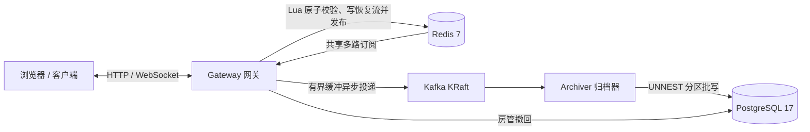

# Maku

基于 Go 构建的高性能分布式实时弹幕推送引擎与异步归档系统。支持跨网关实时弹幕广播、点赞聚合、自适应合批降帧、断线游标补收、零丢失滚动发布迁移、热更新敏感词过滤以及 Prometheus 可观测性监控。

> Maku 服务拆分为 **Gateway**（HTTP/WebSocket 接入与实时广播）和 **Archiver**（Kafka 消费与 PostgreSQL 批量归档）两个独立进程。HTTP 路由与结构化日志全部基于 Go 标准库 `net/http.ServeMux` 与 `log/slog`，全项目仅依赖 5 个核心库（`gorilla/websocket`、`go-redis/v9`、`franz-go`、`pgx/v5`、`prometheus/client_golang`）。

## 系统架构



### 核心特性

* **高并发扇出与自适应合批**：默认 8 条 Redis 共享订阅连接复用全部活跃房间，32 个下行分片按不可变成员快照派发；热房自动触发 `danmaku.batch.v1` 合批协议，显著降低系统调用与写帧开销。

* **短时断线无损补收**：Redis Lua 脚本在同一哈希槽内原子完成幂等去重、禁言校验、限流、追加恢复流与广播发布；客户端断线重连后携带游标请求 `recent` 接口补齐缺失消息，超出恢复窗口自动快照重置。

* **优雅停机与无感滚动发布**：收到 `SIGTERM` 后 `/readyz` 立即返回 `503`，网关按速率分批下发迁移帧引导客户端切换至健康实例并补齐游标，随后安全关闭连接并刷新 Kafka 缓冲区。

* **异步批量归档与死信隔离**：Archiver 按分区执行 PostgreSQL `UNNEST` 批量写入（固定 5 个绑定数组，基于唯一 `event_id` 幂等去重）；瞬时错误触发带抖动指数退避，SQLSTATE `22`/`23` 类数据异常降级逐条写入并记录死信日志。

* **零分配敏感词过滤与热更新**：内置 Aho-Corasick 自动机，支持 `reject`（拦截）与 `mask`（打码）两种模式，统一大小写/全角字符并忽略词间空白，支持 `SIGHUP` 信号原子替换词库。

* **内嵌轻量放映室前端**：支持 B 站数字直播间 FLV/HLS 自动回退播放、Canvas 弹幕轨道调度（支持字号、颜色、速度、透明度、区域与同屏上限调节）以及房管撤回/禁言操作。

## 实测性能概览

测试环境：Apple M4（macOS arm64，Go 1.27.4），Docker Compose 运行 Redis 7.4.12、Kafka 3.9.1 KRaft、PostgreSQL 17.12。详细环境与复现命令见 `docs/benchmarks.md`。

| 测试场景 | 核心指标 | 实测结果 |
| ----- | ----- | ----- |
| **单网关热房扇出**（160 观众、800 msg/s、4s） | 热房数据帧数 / 热房 P99 | **512,000 -> 128,160**（降幅 **74.97%**），P99 **11.457 ms -> 10.728 ms**，0 丢包 0 乱序 |
| **双网关滚动迁移**（24 观众、SIGTERM 交接） | 全员收齐率 / 交接耗时 | 24 位观众按序收齐全部 80 条消息，12 位源网关观众全部迁移，最晚 **606 ms** 完成，单人恢复 P99 **6 ms** |
| **敏感词过滤**（5,000 词条、100 汉字输入） | 单次耗时 / 内存分配 | `Contains` / `Mask` 未命中约 **1.29–1.34 µs**（**0 B / 0 allocs**），命中打码 **3.553 µs** |
| **PostgreSQL 批量归档**（128 条/批，3 轮中位数） | 批写耗时 / 内存分配 | **1.588 ms/批**（原 1.624 ms），**71,236 B/批**（原 74,600 B） |

## 项目结构

```text
maku/
├── cmd/
│   ├── gateway/        # 实时弹幕网关进程
│   ├── archiver/       # Kafka -> PostgreSQL 异步归档进程
│   └── bench/          # 扇出、冷热房隔离、滚动迁移压测工具
├── internal/
│   ├── filter/         # Aho-Corasick 敏感词过滤与热加载
│   ├── httpapi/        # HTTP/WebSocket 路由、访客会话、直播源解析及内嵌 web 资源
│   ├── hub/            # 房间管理、分片派发、自适应合批、背压与滚动迁移
│   ├── metrics/        # Prometheus 业务与归档指标
│   ├── mq/             # Kafka 生产者与批量消费者（含退避重试）
│   ├── protocol/       # WebSocket 协议帧与消息结构定义
│   ├── pubsub/         # Redis Lua 原子日志流、共享订阅多路复用与统计
│   └── store/          # PostgreSQL 连接池、内嵌迁移与 UNNEST 批量写入
├── frontend/           # 放映室前端源码（Vite + TypeScript + React）
├── deploy/             # Prometheus 抓取配置
├── docs/               # 基准测试报告（benchmarks.md）
└── scripts/            # 端到端恢复与迁移校验脚本
```

## 快速开始

### 环境要求

* Go 1.27.4

* Docker Compose & Make

* Node.js / npm（仅修改前端源码时需要）

### 启动中间件与服务

在项目根目录依次执行（两个 Go 进程各占一个终端）：

```sh
make up
make run-archiver

# 在另一个终端启动网关
make run-gateway
```

启动后访问 `http://127.0.0.1:8080/` 即可打开本地放映室：

* 输入纯数字房间号会自动解析对应的 B 站直播间（默认 `6`），优先使用 FLV 播放，失败自动回退至 HLS；网关仅解析播放地址，视频流由 CDN 直出。

* 输入普通字符串房间名可直接体验纯实时弹幕互动；用相同房间名与场次打开多个浏览器窗口即可观察跨连接广播。

### 前端构建

前端源码位于 `frontend/`，修改后执行以下命令重新生成内嵌静态资源并重启网关：

```sh
cd frontend && npm ci && npm run build
```

## 核心机制说明

### 1. 一条弹幕的完整链路

1. **接入与原子发布**：浏览器通过 `POST /api/session` 获取 `HttpOnly` 访客 Cookie 后，连接 `/api/rooms/{room}/{session}/live`。Redis Lua 脚本在同一哈希槽中原子执行请求去重、禁言检查、限流、追加恢复流与广播发布。广播信封保留原始 JSON 以避免 64 位 `user_id` 丢失精度；同一访客在 10 分钟内以相同 `client_msg_id` 重试会返回原 `event_id`。

2. **分片广播与游标补收**：网关默认通过 8 条 Redis 订阅连接服务全部活跃房间，32 个下行分片按成员快照派发。当本地支持 `danmaku.batch.v1` 协议的观众达到 128 人且消息间隔不超过 2 ms 时，自动启用合批（最多等待 5 ms，每批上限 32 条或 32 KiB）。断线客户端通过 `/api/rooms/{room}/{session}/recent?after=<cursor>` 补收遗漏事件（恢复流保留约 256 条，停写 120 秒过期）；游标失效时自动以快照重置。

3. **异步持久化归档**：网关仅将新接受的事件送入有界 Kafka 缓冲区（**`accepted` 回执代表 Redis 已接受并广播**；极端情况下若进程在投递前崩溃或缓冲区满，已广播消息可能缺失历史记录）。Archiver 按分区批写 PostgreSQL，完成后提交位点。

### 2. 连接保活与滚动发布

* 每 30 秒发送 Ping，收到 Pong 后将读超时延长至 60 秒；单连接待写队列上限为 512 帧和 256 KiB，连续 8 次入队失败会踢出慢连接以保护全局吞吐。

* 收到 `SIGTERM` 后，`/readyz` 返回 `503` 触发入口摘流；网关每 100 ms 分批向支持迁移的观众下发交接帧，客户端连上可用网关并补齐游标后主动关闭旧连接，交接完成或超时后退役网关刷盘退出。

### 3. 敏感词过滤

默认关闭。通过命令行参数指定词库文件（每行一词，空行和 `#` 注释行自动忽略）：

```sh
make run-gateway ARGS='-sensitive-words ./words.txt -filter-mode reject'
```

* `reject`：写入 Redis 前拦截，前端提示“内容包含敏感词”。

* `mask`：将命中区间（含词间空白）替换为 `*`，广播、恢复流与历史归档保持同一份脱敏文本。

* 编辑词库后向网关发送 `SIGHUP` 即可原子热重载；加载失败时自动回退保留上一版本。

### 4. Prometheus 监控

网关默认在 `GET /metrics` 暴露 8 个核心业务指标（在线连接、活跃房间、单条/合批写帧、派发等待耗时、丢弃数、慢连接踢出、上行拒绝与 Kafka 投递失败）。归档器可通过 `-metrics-addr 127.0.0.1:9091` 暴露入库行数、死信数与批写耗时。

```sh
make up-monitoring
curl -fsS http://127.0.0.1:8080/metrics
```

Prometheus 默认运行在 `127.0.0.1:9090`（可用 `PROMETHEUS_PORT` 覆盖），抓取目标为 `host.docker.internal:8080`；原生 Linux 环境下需让网关监听容器可访问的宿主机地址。

## 配置项一览

| 配置项 | 默认值 / 说明 |
| ----- | ----- |
| `REDIS_ADDR` | `127.0.0.1:6379`（集群模式以逗号分隔种子节点） |
| `KAFKA_BROKERS` | `127.0.0.1:9092`（多节点以逗号分隔） |
| `DATABASE_URL` | 默认连接 Compose 的本机 PostgreSQL 5432 `danmaku_db` |
| `DANMAKU_MOD_ROOM` / `DANMAKU_MOD_TOKEN` | 同时配置后，允许指定房间携带 Bearer 密钥执行撤回或限时禁言 |
| `-pubsub-shards` / `-room-shards` | Redis 订阅连接数（默认 `8`）与下行派发分片数（默认 `32`） |
| `-batch-window` / `-batch-min-viewers` | 热房合批最大等待窗口（默认 `5ms`）与触发人数阈值（默认 `128`） |
| `-migration-batch` / `-migration-inflight` / `-migration-timeout` | 滚动迁移每批邀请数（`100`）、最大在途交接数（`64`）与超时时间（`30s`） |
| `-log-format` | 网关与归档器均支持 `json`（默认）和 `text` |
| `-allow-dev-guest` | 默认关闭；开启后允许回环地址无 Origin 压测客户端以 `uid` 参数建连 |

## 测试与压测验证

```sh
# 单元测试（含竞态检测）与静态检查
make test
go vet ./...

# 性能与稳定性压测
make bench-fanout ARGS='-viewers 160 -rate 800 -seconds 4'
go run ./cmd/bench rooms
go build -o /tmp/maku-gateway ./cmd/gateway
go run ./cmd/bench migration -gateway /tmp/maku-gateway -viewers 24
```

设置 `DANMAKU_TEST_REDIS_ADDR` 与 `DANMAKU_TEST_DATABASE_URL` 可激活 Redis 和 PostgreSQL 集成测试；双网关迁移集成测试需额外配置 `DANMAKU_TEST_GATEWAY_A`、`DANMAKU_TEST_GATEWAY_B` 并运行归档器（房管测试使用 `DANMAKU_MOD_ROOM=retry` 与对应密钥）。